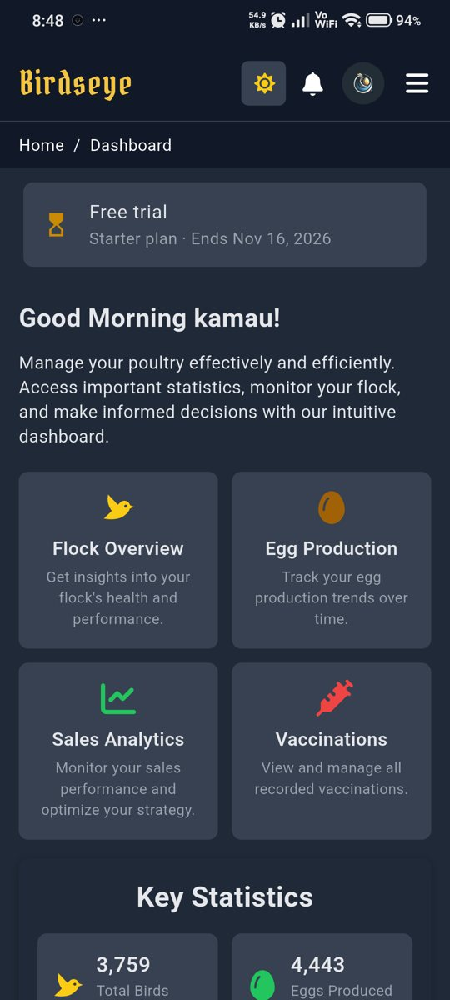
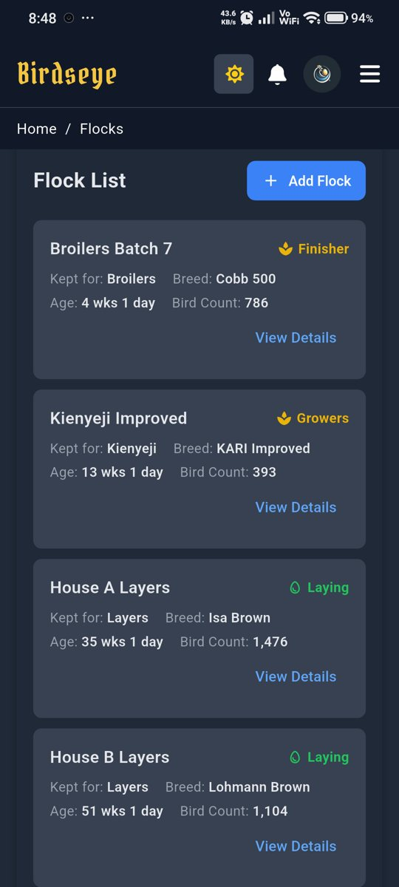
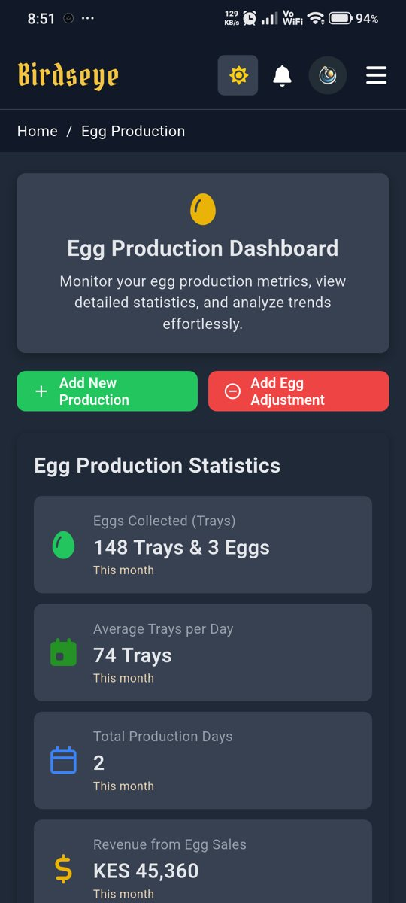
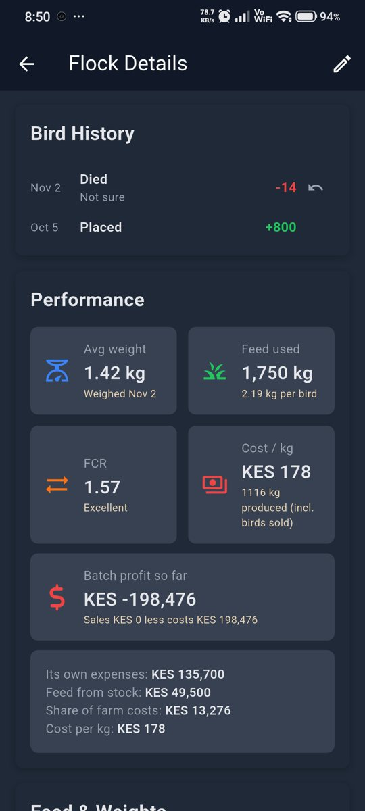
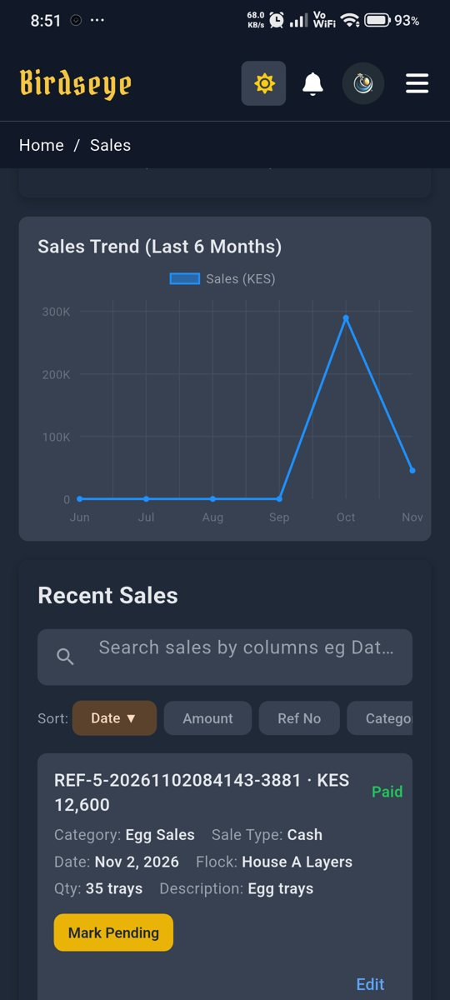
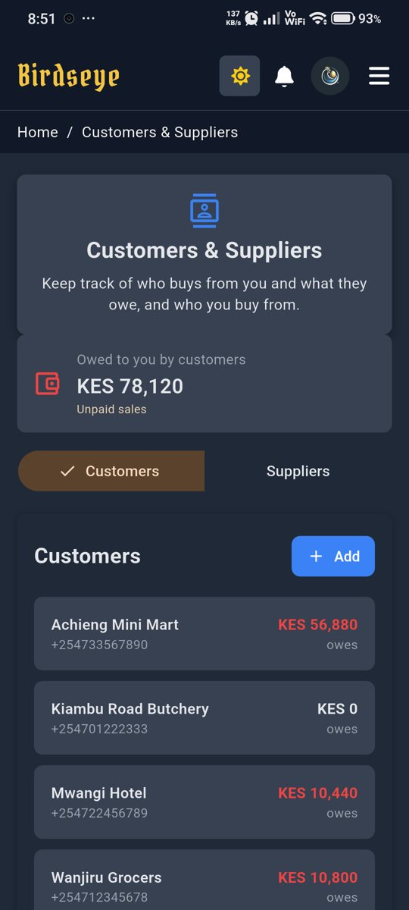

<div align="center">


# Birdseye for Android

**Run your whole poultry farm from your phone.**

Batches, eggs, feed, vaccinations, sales, customers and batch finances in one app,
for layers, broilers, kienyeji and breeders. Made in Kenya by [816 Dynamics](https://www.816-dynamics.com).

[](https://github.com/codeDaydreamer/birdseye-releases/releases/latest)
[](https://github.com/codeDaydreamer/birdseye-releases/releases)


### [Download the latest APK](https://server.birdseye-poultry.com/downloads/birdseye.apk)

[Website](https://www.birdseye-poultry.com) &nbsp;·&nbsp; [Install guide](https://www.birdseye-poultry.com/android) &nbsp;·&nbsp; [All releases](https://github.com/codeDaydreamer/birdseye-releases/releases) &nbsp;·&nbsp; [Privacy](https://www.birdseye-poultry.com/privacy)

</div>

---

## Screenshots

<table>
  <tr>
    <td align="center" width="33%"><br><b>Dashboard</b><br>Today's farm at a glance</td>
    <td align="center" width="33%"><br><b>Batches</b><br>Age, stage and bird count</td>
    <td align="center" width="33%"><br><b>Eggs</b><br>Collections, trays and laying trends</td>
  </tr>
  <tr>
    <td align="center"><br><b>Performance</b><br>Weights, feed, FCR and cost per kg</td>
    <td align="center"><br><b>Sales</b><br>Every sale, paid or pending</td>
    <td align="center"><br><b>Customers</b><br>Who owes you, at a glance</td>
  </tr>
</table>

## Features

| | |
|---|---|
| **Batches and birds** | Every batch with its age, stage and live bird count, kept up to date from deaths, sales and transfers. |
| **Eggs** | Daily collections in trays and pieces, and laying trends per batch. |
| **Feed and performance** | Feed used from stock, weigh-ins, FCR and cost per kg for broilers. |
| **Hatchery** | Settings, candling, hatch results and customer bookings. |
| **Vaccinations** | A schedule for each batch, with reminders on your phone before each one is due. |
| **Sales and customers** | Sales that move stock, paid or on credit, with customer statements and balances. |
| **Costs and finances** | Expenses per batch or farm-wide, and what each batch really earned. |
| **Your whole team** | Owners, managers and workers each sign in on their own phone and record where the work happens. |
| **Private and secure** | Fingerprint unlock, and sign-in with your email or Google account. |
| **Web and Android together** | One account. Whatever you record on the phone shows up in the web app, and the other way round. |

## Install

1. On your phone, open **[Download the latest APK](https://server.birdseye-poultry.com/downloads/birdseye.apk)**. The file is about 68 MB, so Wi-Fi helps.
2. Open the file from the download notification, or from **Downloads** in your Files app.
3. If Android asks, tap **Settings** and turn on **Allow from this source** for your browser, then go back.
4. Tap **Install**, open Birdseye and sign in, or create an account. New farms start with a free trial.

A step-by-step guide with pictures is at [birdseye-poultry.com/android](https://www.birdseye-poultry.com/android).

## Updates

Birdseye checks for new versions on its own and offers each one with a short note on what changed.
Tap **Update** and the app downloads, checks and installs it for you.
Every version is listed on the [releases page](https://github.com/codeDaydreamer/birdseye-releases/releases).

## Verify your download

Every release is built and signed automatically with the same Birdseye release key, so updates install
over your existing app. To confirm an APK is genuine, check its signing certificate:

```
SHA-256: e3500db34493247fe01a87e6d027a44553e56ac69919103602fac5371a744f1d
```

```sh
apksigner verify --print-certs birdseye-1.0.2.apk
```

Each release also publishes a `latest.json` with the APK's SHA-256 checksum and size.

## Requirements

- Android 7.0 or newer
- An internet connection to sign in and sync

## Support

- WhatsApp: [+254 792 803 063](https://wa.me/254792803063)
- Email: [support@birdseye-poultry.com](mailto:support@birdseye-poultry.com)
- Web: [birdseye-poultry.com/contact](https://www.birdseye-poultry.com/contact)

Found a problem with a release? [Open an issue](https://github.com/codeDaydreamer/birdseye-releases/issues) with your Android version and what happened.

---

<div align="center">

Google Play release coming soon.

© 2026 [816 Dynamics](https://www.816-dynamics.com). All rights reserved.

</div>
